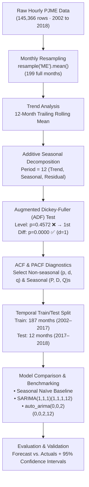
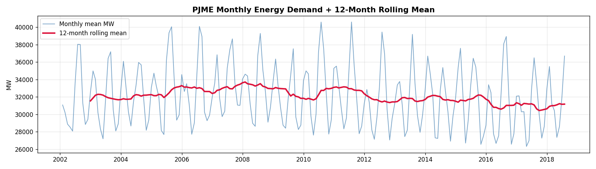
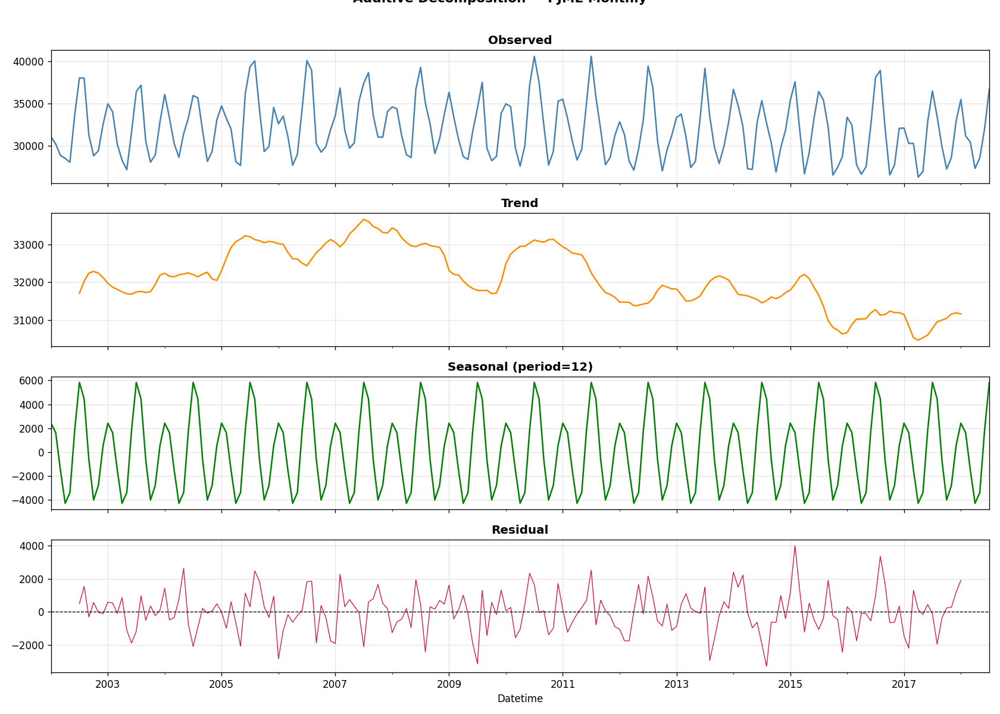
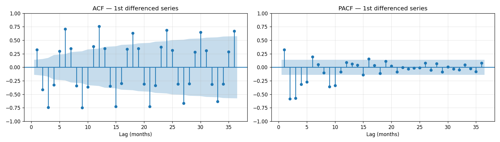
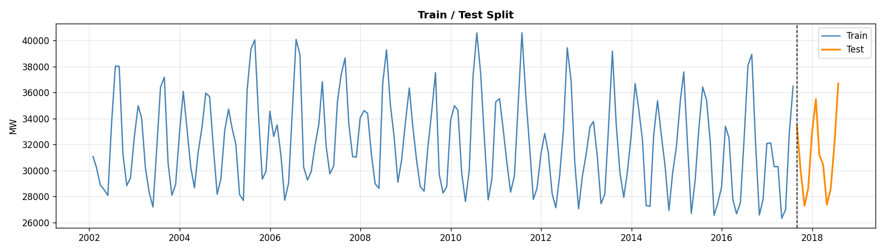
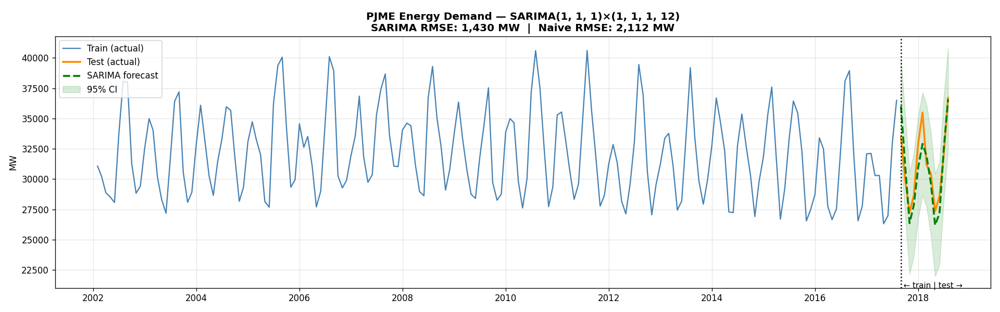

# ⚡ PJME Hourly Energy Demand Forecasting — End-to-End Time Series Analysis

[](https://www.python.org/)
[](https://www.statsmodels.org/)
[](https://alkaline-ml.com/pmdarima/)
[](LICENSE)

An end-to-end Time Series Analysis and Forecasting pipeline built on **145,366 hourly energy consumption records** (2002–2018) from PJM Interconnection LLC (`PJME_hourly.csv`). Developed as part of the **SoftNexis Internship Project**.

---

## 📌 Project Overview

PJM Interconnection LLC (PJME) is a regional transmission organization in the eastern United States that coordinates the movement of wholesale electricity. Accurate forecasting of electricity demand (measured in Megawatts, MW) is crucial for grid reliability, peak load capacity planning, and energy market scheduling.

This project implements a complete, mathematically grounded classical time series forecasting workflow:
1. **Frequency Normalization**: Aggregating raw hourly timestamps into calendar monthly means (`resample('ME')`).
2. **Trend & Seasonality Isolation**: Trailing 12-month rolling mean and classical **Additive Seasonal Decomposition**.
3. **Statistical Stationarity Verification**: Augmented Dickey-Fuller (ADF) hypothesis testing to identify integration order ($d$).
4. **Order Identification**: Autocorrelation (ACF) and Partial Autocorrelation (PACF) analysis for seasonal and non-seasonal terms.
5. **Model Estimation**: Seasonal Autoregressive Integrated Moving Average (**SARIMAX**) compared against a Seasonal Naïve baseline and `pmdarima`'s `auto_arima`.

---

## 🏗️ Architecture & Workflow



---

## 🔬 Step-by-Step Methodology & Visualizations

### 1. Monthly Resampling & Rolling Mean
Raw data is aggregated using `resample('ME').mean()`. The partial last month (August 2018, containing only 3 days of observations) is trimmed to prevent downward boundary distortion, leaving **199 clean monthly observations**.

A **12-month trailing moving average** was fitted to smooth seasonal cycles:
- **Observation**: The rolling average remains nearly horizontal (~31,000–33,000 MW) across 16 years.
- **Model Form Selection**: Because the seasonal oscillation amplitude does not scale with the mean level of the series, an **Additive Model** ($Y_t = T_t + S_t + R_t$) is statistically appropriate rather than a Multiplicative model.



---

### 2. Seasonal Decomposition
Decomposition separates the series into three constituent components:
$$\text{Observed}_t = \text{Trend}_t + \text{Seasonal}_t + \text{Residual}_t$$

- **Seasonal Component**: Pronounced bi-modal yearly peaks occurring during winter (heating load in January) and summer (air conditioning load in July/August).
- **Residual Component**: $\mu = +17.9\text{ MW} \approx 0$, demonstrating that the additive decomposition cleanly extracts the cyclical dynamics without systemic leftover drift.



---

### 3. Stationarity Testing (ADF)
SARIMA modeling requires weak stationarity (constant mean, constant variance, and autocovariance dependent only on lag distance).

| Series Specification | Test Statistic | p-value | Critical (5%) | Result |
|---|:---:|:---:|:---:|:---:|
| **Level Series ($d=0$)** | `-1.6497` | `0.4572` | `-2.879` | Non-Stationary (Fail to reject $H_0$) |
| **First Difference ($d=1$)** | `-6.4356` | `0.0000` | `-2.879` | **Stationary** (Reject $H_0$ at $p < 0.001$) |

**Conclusion**: First-order differencing ($d = 1$) achieves statistical stationarity.

---

### 4. Correlation Structure: ACF & PACF
Lags up to 36 months (3 full annual cycles) were inspected on the first-differenced series:
- **Autocorrelation (ACF)**: Rapid decay in non-seasonal lags, with clear seasonal spikes at lags 12, 24, and 36 ($s=12$).
- **Partial Autocorrelation (PACF)**: Significant coefficients at lag 1 and seasonal multiples, informing initial model parameterization:
  $$\text{SARIMA}(p=1, d=1, q=1) \times (P=1, D=1, Q=1)_{12}$$



---

### 5. Temporal Train/Test Split
To prevent data leakage, a strict temporal split was applied:
- **Training Set**: 187 months (January 2002 – July 2017)
- **Test Set**: 12 months (August 2017 – July 2018) — held out for out-of-sample benchmarking.



---

## 📊 Forecast Results & Evaluation

Models were evaluated out-of-sample across the 12-month test horizon using **Root Mean Squared Error (RMSE)**:
$$\text{RMSE} = \sqrt{\frac{1}{N}\sum_{t=1}^{N} \left(y_t - \hat{y}_t\right)^2}$$

| Model | Order | Test RMSE | vs. Naïve Baseline |
|---|:---:|:---:|:---:|
| **Seasonal Naïve Baseline** | $\hat{y}_t = y_{t-12}$ | **2,112.1 MW** | Benchmark (0.0%) |
| **Auto-ARIMA (`pmdarima`)** | $(0, 0, 2) \times (0, 0, 2, 12)$ | **1,978.1 MW** | +6.3% improvement |
| **Manual SARIMAX** ⭐ | **$(1, 1, 1) \times (1, 1, 1, 12)$** | **1,429.9 MW** | **+32.3% improvement** |

### Final Forecast vs. Actual Test Set
The manual SARIMA model accurately captures both summer cooling and winter heating peaks, closely hugging actual values within the 95% confidence interval band.



---

## 📁 Repository Structure

```
├── energy_forecast.ipynb        # Clean Jupyter notebook with full code & outputs
├── PJME_hourly.csv              # Hourly energy consumption dataset
├── requirements.txt             # Python dependencies
├── .gitignore                   # Ignored files (checkpoints, env, caches)
├── README.md                    # Project documentation
│
├── plot_01_rolling_mean.png     # Monthly resampled + 12M moving average
├── plot_02_decomposition.png    # Additive seasonal decomposition plot
├── plot_03_acf_pacf.png         # ACF and PACF correlograms
├── plot_04_train_test.png       # 187M train vs. 12M test split visualization
└── plot_05_final_forecast.png   # Out-of-sample forecast with 95% CI
```

---

## 🚀 Getting Started

### 1. Clone the Repository
```bash
git clone https://github.com/CodeWithAnurup/PJME-Energy-Demand-Forecasting.git
cd PJME-Energy-Demand-Forecasting
```

### 2. Create and Activate Environment
```bash
# Windows
python -m venv venv
venv\Scripts\activate

# Linux / macOS
python3 -m venv venv
source venv/bin/activate
```

### 3. Install Dependencies
```bash
pip install -r requirements.txt
```

### 4. Run the Notebook
Launch Jupyter or open in VS Code:
```bash
jupyter notebook energy_forecast.ipynb
```

---

## 🛠️ Tech Stack
- **Language**: Python 3.10+
- **Data Manipulation**: `pandas`, `numpy`
- **Time Series & Econometrics**: `statsmodels` (`seasonal_decompose`, `adfuller`, `plot_acf`, `plot_pacf`, `SARIMAX`), `pmdarima`
- **Model Evaluation**: `scikit-learn` (`mean_squared_error`)
- **Data Visualization**: `matplotlib`

---

## 👨‍💻 Author
**Anurup**
- GitHub: [@CodeWithAnurup](https://github.com/CodeWithAnurup)
- SoftNexis Internship — Data Science & Machine Learning (Project 3)
